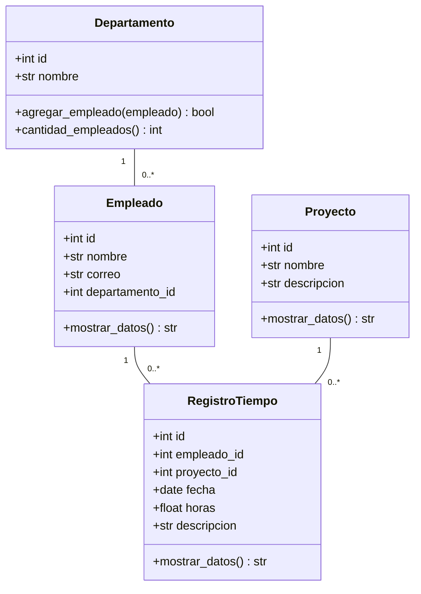

## Diagrama de clases

## Relaciones → código y tablas

| Relación UML | En Python | En la base de datos |
|---|---|---|
| Departamento 1 — 0..* Empleado | `Departamento._empleados` (lista) y `Empleado.departamento_id` | `empleado.departamento_id` (FK, `ON DELETE SET NULL`) |
| Empleado 1 — 0..* RegistroTiempo | `RegistroTiempo.empleado_id` | `registro_tiempo.empleado_id` (FK, obligatoria) |
| Proyecto 1 — 0..* RegistroTiempo | `RegistroTiempo.proyecto_id` | `registro_tiempo.proyecto_id` (FK, obligatoria) |

`RegistroTiempo` es una clase propia porque la relación Empleado–Proyecto
guarda información (fecha, horas, descripción).

## Responsabilidades por capa

| Capa | Carpeta / archivo | Responsabilidad |
|---|---|---|
| Dominio | `src/dominio/` | Clases, atributos protegidos y reglas de validez. No conoce SQL. |
| Persistencia | `src/persistencia/` | Conexión, creación de tablas y un DAO por entidad (todo el SQL). |
| Interacción | `src/main.py`, `src/menu_*.py` | Menús, lectura de datos, mensajes al usuario. No contiene SQL. |
| Apoyo | `src/utilidades.py`, `src/menu_comun.py` | Validadores reutilizables y ayudas de entrada por consola. |
